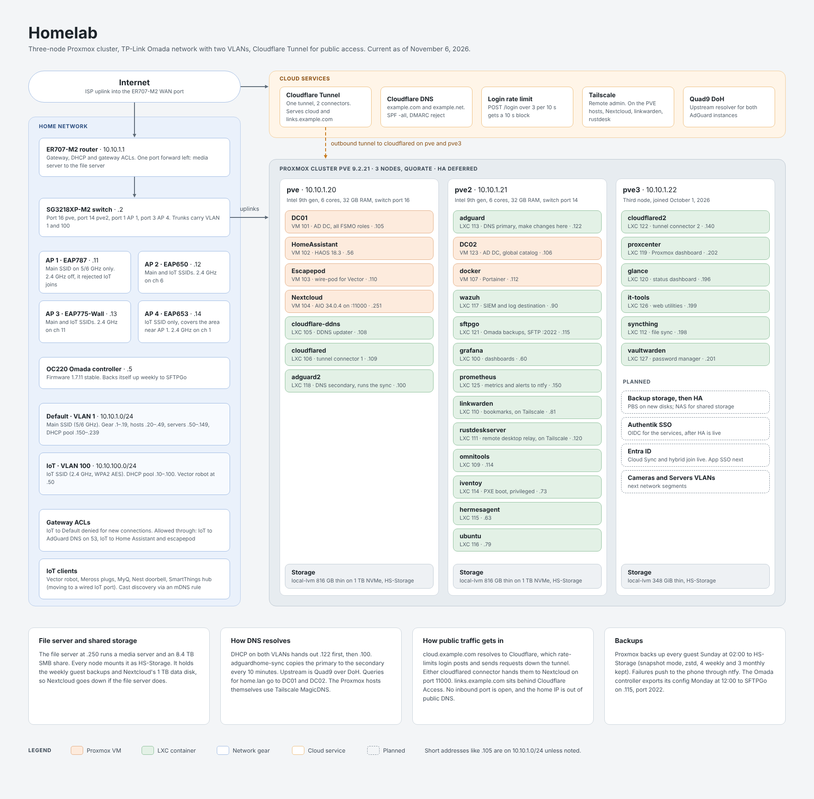

# Homelab

Process documentation for a self-hosted home network and a three-node Proxmox VE cluster. These are working notes: what was built, how it's configured, what broke, and how it got fixed.

All hostnames, domains, SSIDs and addresses in this repo are placeholders. The address scheme is remapped (10.10.x.x), public domains are `example.com` / `example.net`, and the Active Directory domain is `home.lan`. No credentials, MAC addresses, public IPs or account identifiers are published.



## Stack

| Layer | What runs |
|---|---|
| Router, switch, Wi-Fi | TP-Link Omada: ER707-M2 router, SG3218XP-M2 switch, four EAPs, OC220 hardware controller |
| Hypervisor | Proxmox VE 9.2, three nodes, quorate cluster |
| DNS | Two AdGuard Home instances kept in sync with adguardhome-sync |
| Directory | Active Directory on two Windows Server 2022 domain controllers, synced to Entra ID with Cloud Sync |
| Monitoring | Prometheus and Alertmanager to ntfy, Grafana, Wazuh with Omada syslog, Glance and ProxCenter dashboards |
| Remote access | Cloudflare Tunnel with two connectors, Cloudflare Access on selected apps, Tailscale for admin; no inbound web ports open |
| Apps | Nextcloud AIO, Home Assistant, Linkwarden, Vaultwarden, Syncthing, IT-Tools, Escapepod (wire-pod) and a handful of smaller LXC services |

## Layout

```
docs/
  architecture.md     diagrams: traffic paths, DNS, IoT firewall, identity
  decisions.md        why things are built the way they are
  images/             rendered network map
  network/            IP plan, VLANs and firewall rules, Wi-Fi tuning, Omada controller
  proxmox/            cluster build, NIC outage, storage and backups, guest inventory, host firmware
  monitoring/         Prometheus alerting, Wazuh, dashboards
  dns/                AdGuard Home primary/secondary and sync
  active-directory/   domain controllers, DC02 build, promotion failures
  identity/           Entra ID tenant, Cloud Sync, hybrid join, app SSO
  remote-access/      Cloudflare Tunnel and Access, Nextcloud AIO behind the tunnel
  apps/               Escapepod (wire-pod), Linkwarden, SavaPage and Splunk (both deleted)
  runbooks/           repeatable procedures (adding a service)
  changelog.md        dated change log
  open-items.md       what's still unresolved
```
