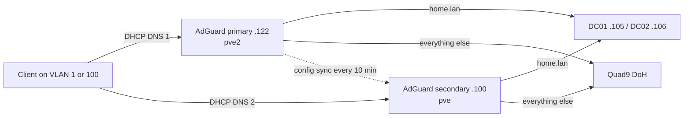
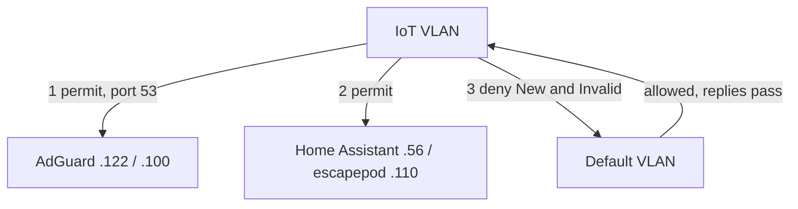
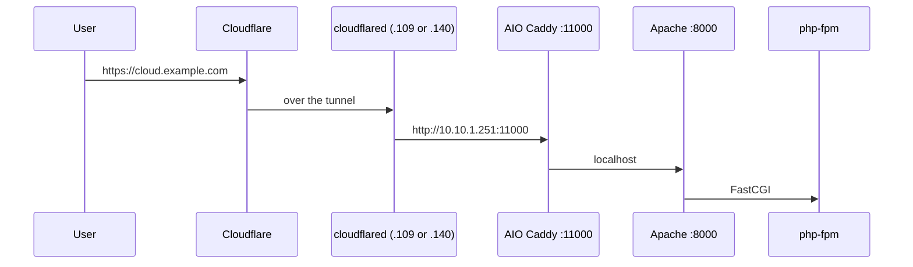
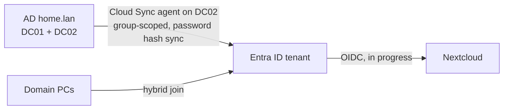

# Architecture

## Network and traffic paths

```mermaid
flowchart LR
  internet((Internet))
  cf[Cloudflare edge<br/>rate limit on /login]
  router[ER707-M2 router<br/>10.10.1.1]
  switch[SG3218XP-M2 switch]
  aps[AP 1 to AP 3<br/>Main SSID 5/6 GHz<br/>IoT SSID 2.4 GHz on AP 2, AP 3]
  ap4[AP 4<br/>IoT SSID only]

  subgraph default[VLAN 1 Default 10.10.1.0/24]
    pve[pve .20]
    pve2[pve2 .21]
    pve3[pve3 .22]
    clients[PCs and phones]
  end

  subgraph iot[VLAN 100 IoT 10.10.100.0/24]
    iotdev[Plugs, TVs, hubs, robot]
  end

  internet --- cf
  internet --- router
  router --- switch
  switch --- pve & pve2 & pve3
  switch --- aps
  switch --- ap4
  aps --- clients
  aps --- iotdev
  ap4 --- iotdev
  cf -. outbound tunnel .- pve
  cf -. outbound tunnel .- pve3
```

No inbound web ports are open. Both cloudflared connectors dial out to Cloudflare, and Cloudflare sends requests for public hostnames down those connections. `links.example.com` passes through Cloudflare Access first; `cloud.example.com` goes straight to Nextcloud's own login.

## DNS resolution



The two AdGuards sit on different nodes. Either node can go down and DNS keeps working.

## IoT firewall



## Remote access path to Nextcloud



## Monitoring

See [monitoring overview](monitoring/overview.md#how-an-alert-reaches-the-phone).

## Identity


