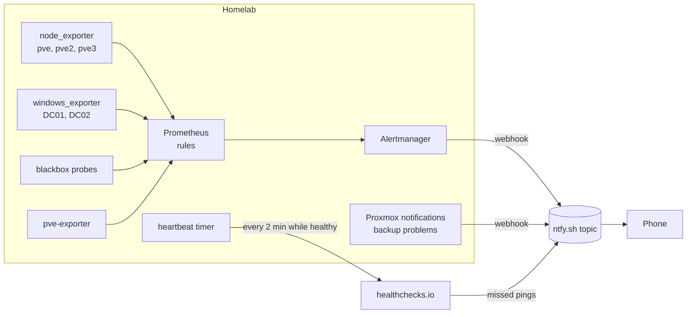

# Monitoring overview

Built on 2026-10-28 after pve dropped off the network with nothing to warn about it. Each tool has one job.

| Tool | Where | Job |
|---|---|---|
| Prometheus + Alertmanager | CT 125 on pve2, 10.10.1.150 | Metrics history (90 days) and every push alert |
| Grafana | CT 100 on pve2, 10.10.1.60 | Dashboards over Prometheus. Not needed for alerting |
| Wazuh | CT 117 on pve2, 10.10.1.90 | Logs and security events from the nodes, DCs, a workstation and the Omada gear |
| Glance | CT 120 on pve3, 10.10.1.196 | At-a-glance status page, no history |
| ProxCenter | CT 119 on pve3, 10.10.1.202 | Proxmox inventory, per-guest history, topology, audit log |
| healthchecks.io | external | Heartbeat from Prometheus, so a dead house still alerts |
| ntfy.sh | external | Push notifications to the phone, on a private random topic |

Details: [Prometheus and alerting](prometheus.md), [Wazuh](wazuh.md), [Dashboards](dashboards.md).

## How an alert reaches the phone

Alerts don't depend on Grafana, Glance or ProxCenter being up. They do depend on internet access, which is why the heartbeat exists: if the house loses power or its connection, the pings stop and healthchecks.io sends the alert from outside.

## What was retired

- Homepage (CT 112). Glance already covers everything it showed. Stopped, then cleared for deletion after the 2026-11-01 backup.
- Splunk (CT 108). Wazuh is the log destination, so Splunk had no job left. Cleared for deletion once pve3's backup was confirmed good.

## Secrets

The ntfy topic, the healthchecks.io ping URL, the Proxmox API token secret and the Wazuh indexer password all live only on the hosts that use them, in root-only files. The ntfy topic is the only thing protecting the notification channel, so it never goes in a doc or a repo.
